  

<a href="https://k-kiron.github.io/">Open interactive terminal ↗</a> &nbsp;·&nbsp; Ask about my work, explore <code>skills</code>, or trace a decision.

### `~ / whoami`

I'm **Wenhao XU**, an **AI/ML PhD student at Université de Montréal & Mila**, working on **rule alignment for language models**.

Do models actually use the rules we give them? I study how explicit rules shape model decisions, with an eye toward AI we can understand and trust.

**AI Safety** &nbsp;·&nbsp; **Alignment** &nbsp;·&nbsp; **Trustworthy AI** &nbsp;·&nbsp; **Mechanistic Interpretability**

### `~ / now`

I turn questions about model behavior into experiments, and recurring development problems into tools. Lately, that means:

- **Privacy & trustworthy systems.** Build local text de-identification tools and evaluate detection coverage and downstream utility separately.
- **Agent workflows.** Make execution timelines, verification, and handoffs easier to inspect across development tools.
- **Interaction experiments.** Explore task resumption, editing interfaces, and small 3D browser experiences.

### `~ / building`

| Project | What it does |
| :--- | :--- |
| [**Runward**](https://github.com/K-kiron/runward) | A local desk for coding-agent activity, execution timelines, transcript inspection, and handoffs. |
| [**ContextVeil**](https://github.com/K-kiron/contextveil) | Local text de-identification with consistent entity replacements and reproducible privacy/utility evaluations. |

[**TaxAgent**](https://github.com/K-kiron/TaxAgent) — local return preparation for supported Quebec/federal salary and student cases. &nbsp;·&nbsp; [**ReviewBudget**](https://github.com/K-kiron/ReviewBudget) — plan pull request verification around an explicit budget.

### `~ / skills`

I build open-source agent skills that turn "looks good" into something you can inspect, replay, or challenge.

| Skill | What it does |
| :--- | :--- |
| [**RepoQuest**](https://github.com/K-kiron/RepoQuest) | Investigate a Python bug in an offline case, then reveal the tested fix. |
| [**RageClick**](https://github.com/K-kiron/RageClick) | Replay impatient-user failures in local web apps. |
| [**ProveIt**](https://github.com/K-kiron/ProveIt) | Run the same regression test before and after a fix. |
| [**SkillClash**](https://github.com/K-kiron/SkillClash) | Find conflicting agent instructions. Trace them to the source. |
| [**PaperCourt**](https://github.com/K-kiron/PaperCourt) | Put empirical ML claims on trial against their evidence. |

<a href="https://k-kiron.github.io/RepoQuest/">Play RepoQuest →</a> &nbsp;·&nbsp; <a href="https://k-kiron.github.io/RageClick/">Watch RageClick →</a>

### `~ / upstream`

[**freeCodeCamp**](https://github.com/freeCodeCamp/freeCodeCamp/pull/70294) — clearer Python curriculum hints, merged. &nbsp;·&nbsp; [**pytest**](https://github.com/pytest-dev/pytest/pull/15087) — proposed fix for warning-filter precedence across test scopes.

---

Montreal &nbsp; / &nbsp; <a href="https://www.linkedin.com/in/k-kiron/">LinkedIn</a> &nbsp; / &nbsp; <a href="https://github.com/K-kiron?tab=repositories">All repositories ↗</a>
